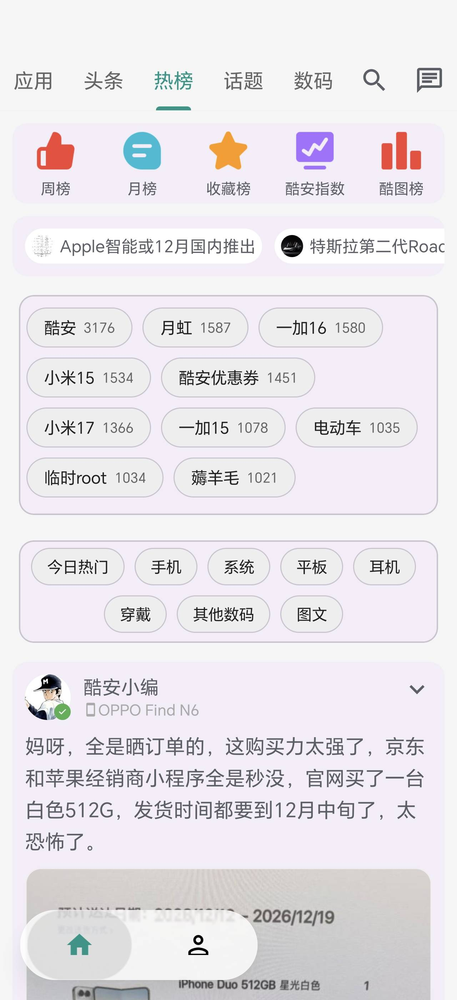
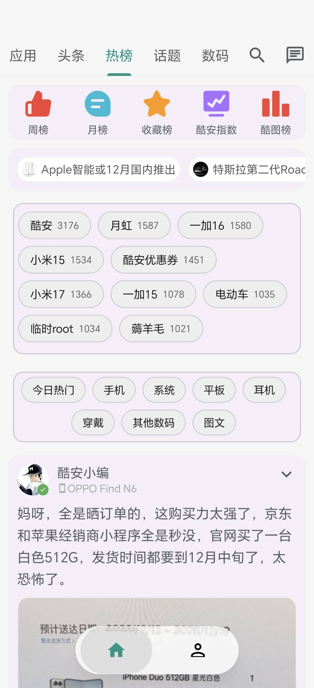
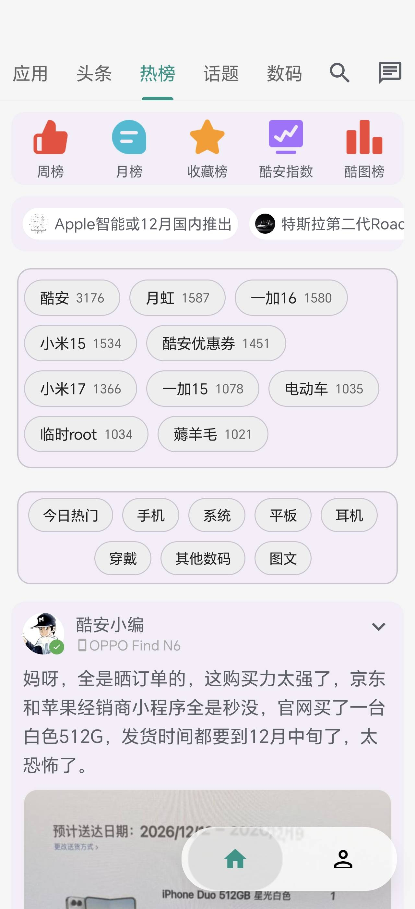

# c001apk_next

fake coolapk

<p align="center">
  基于上游 <a href="https://github.com/kongwufang/c001apk_next">kongwufang/c001apk_next</a>，适配<strong>荣耀 AI 随心握</strong>握持优化，并包含液态玻璃、全站官方配色等界面优化。
</p>

---

## 🤖 荣耀 AI 随心握适配

荣耀 AI 随心握会根据当前握持方向自动偏移底部导航栏，避免单手操作时拇指够不到屏幕另一侧的按钮。

| 默认居中 | 左手握持 | 右手握持 |
|:---:|:---:|:---:|
|  |  |  |
| 底部导航栏居中显示 | 底栏向左侧偏移，便于左手拇指操作 | 底栏向右侧偏移，便于右手拇指操作 |

> 单手握持时底栏自动靠向握持侧，双手/平放时回到正中。
>
> 非荣耀设备自动跳过该适配，对原版行为零影响。

## 下载 / 更新

最新正式版：**[release-latest](https://github.com/funnystyle1991/c001apk_next/releases/tag/release-latest)**（正式版与测试版共用同一 versionCode，可互相覆盖安装）

App 内「设置 → 关于」可检查更新：更新检查走自建接口，支持多线路下载。

## 关于本项目 / Origin

本项目基于上游两个开源项目改编，沿用 **GNU Affero General Public License v3.0 (AGPL-3.0)** 发布，详见 [`LICENSE.md`](./LICENSE.md)。

代码主干血统（lineage）：

```
bggRGjQaUbCoE/c001apk-flutter  (Flutter 重写，已归档)
        │
        ▼
RzdPai/c001apk                (Kotlin 重写，本项目代码主线)
        │
        ▼
kongwufang/c001apk  ──fork──>  kongwufang/c001apk_next  (本仓库上游)
                                        │
                                        ▼
                              funnystyle1991/c001apk_next  (本 fork)
```

- 上游 Kotlin 主线：[RzdPai/c001apk](https://github.com/RzdPai/c001apk)
- 上游 Flutter 重写（已归档）：[bggRGjQaUbCoE/c001apk-flutter](https://github.com/bggRGjQaUbCoE/c001apk-flutter)

如上游更新，本项目会视情况进行同步（rebase/merge）。所有上游版权与许可声明均完整保留在 `LICENSE.md`。

---

Token/LoginUtil from: [CoolbbsYou](https://github.com/WaitFme/CoolbbsYou)
